# spice-lite

[](https://github.com/Hopexist/spice-lite/actions/workflows/ci.yml)

A small SPICE-style circuit simulator in Python. It parses a subset of the SPICE netlist
format and solves DC operating point, DC sweep, AC small-signal and transient analyses with
Modified Nodal Analysis (MNA), using Newton-Raphson for diodes. Results are checked against ngspice.

**Status:** parser, DC, AC, transient, diodes and level-1 MOSFETs with Newton-Raphson (DC, AC, transient), `.ic`/UIC,
controlled sources with op-amps, adaptive time stepping, a command line, sparse solves and a CI workflow are done (see the
roadmap in `CLAUDE.md`).

## Try it in your browser

**Live demo: https://hopexist.github.io/spice-lite/** (placeholder until GitHub Pages is enabled for this repository)

Paste or edit a netlist, press Run (Ctrl/Cmd+Enter), and get interactive plots and tables. spicelite runs in your browser through
[Pyodide](https://pyodide.org) inside a Web Worker, so there is no server and nothing you type leaves the page. Every bundled
example can overlay precomputed ngspice curves with an error panel; share links (`#n=...`) reproduce a circuit.

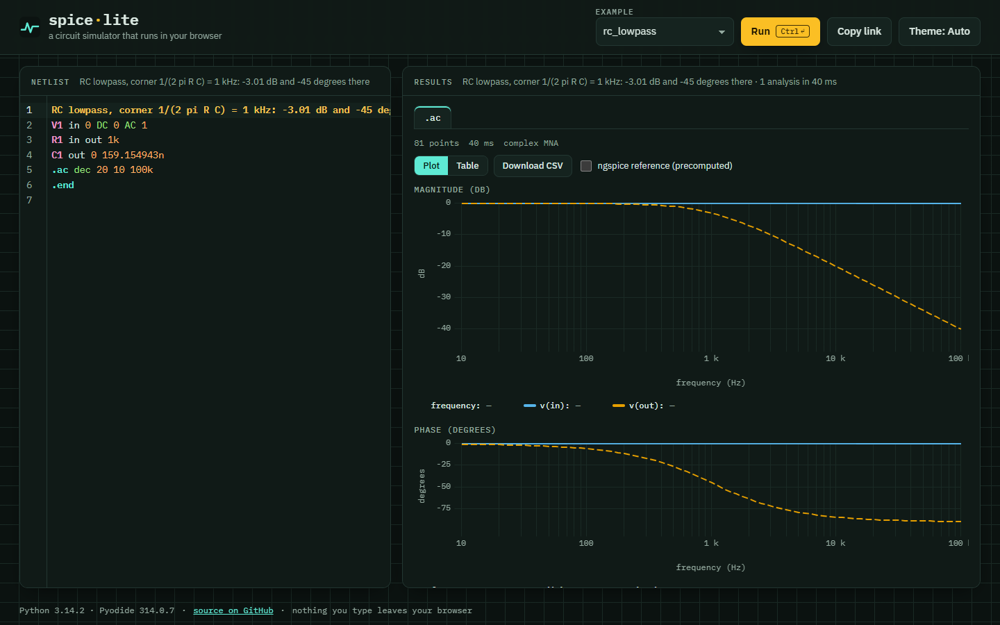

```
cd web
npm ci
npm run dev        # local dev server
npm test           # unit tests + every example through real Pyodide
npm run build      # static site in web/dist (works from a sub-path such as /spice-lite/)
npm run e2e        # Playwright smoke tests against the built site (PW_CHANNEL=msedge to use an installed browser)
```

The first run downloads Python, numpy and scipy (about 11 s cold); later runs are cached. Limits and design choices are in `DECISIONS.md` (D30-D36).

## Install and quick start

```
pip install -e .[dev]
pytest -q
spicelite run examples/rc_lowpass.cir --csv out --plot out     # run a netlist: tables, CSV, PNG
python -m spicelite.plotting      # regenerate the plots in docs/
```

## Command line

```
spicelite run NETLIST [--csv DIR] [--plot DIR] [--solver auto|dense|sparse] [-q]
spicelite --version | --help
```

`run` executes every analysis the netlist asks for (`.op`, `.dc`, `.ac`, `.tran`) and prints a table for
each (long tables show the first and last five rows). `--csv DIR` writes `<netlist>_<analysis>.csv` with every
row (AC columns are `mag_db(...)` and `phase_deg(...)`), `--plot DIR` writes a PNG per analysis, `-q` suppresses
the tables. A netlist with no analysis directive runs `.op` and says so on stderr.

| Exit code | Meaning |
|---|---|
| 0 | success (warnings, e.g. an open-loop op-amp, go to stderr) |
| 1 | the netlist or simulation failed: `NetlistError` (with its line number), singular circuit, Newton did not converge |
| 2 | usage error or unreadable file |

```python
from spicelite import parse
from spicelite.analysis.dc import op, dc_sweep
from spicelite.analysis.ac import ac, magnitude_db
from spicelite.analysis.tran import tran

print(op(parse(open("examples/divider.cir").read())).voltages)         # {'in': 10.0, 'out': 6.67}

r = ac(parse(open("examples/rc_lowpass.cir").read()))                   # .ac dec 20 10 100k
print(magnitude_db(r.voltages["out"])[:3])                              # dB at the first points

t = tran(parse(open("examples/rc_step.cir").read()), method="trap")     # or method="be"
print(t.time[-1], t.voltages["out"][-1])

s = dc_sweep(parse(open("examples/diode_clamp.cir").read()))            # .dc V1 -5 5 0.1, Newton per point
print(s.voltages["out"][[0, 50, -1]], s.iterations.max())

d = tran(parse(open("examples/diode_rectifier_tran.cir").read()))       # Newton at every time step
print(d.voltages["out"].max(), d.iterations.max(), d.cuts)              # peak, worst Newton iterations, step halvings
```

The ngspice comparison tests skip (with a message) unless ngspice is found: put
`ngspice_con.exe` / `ngspice.exe` on `PATH`, or set the `NGSPICE` environment variable to
the executable.

## Supported

| | |
|---|---|
| Elements | `R`, `C`, `L`, `D` (diode), `V` and `I` (DC, `AC mag [phase_deg]`, `PULSE(...)`, `SIN(...)`), controlled sources `E` (VCVS), `G` (VCCS), `F` (CCCS), `H` (CCVS); an op-amp is an `E` with gain 1e6; `M` (level-1 MOSFET) |
| Models | `.model name D(IS=.. N=.. RS=..)`, `.model name NMOS\|PMOS(LEVEL=1 VTO=.. KP=.. LAMBDA=.. GAMMA=.. PHI=..)` |
| Directives | `.op`, `.dc source start stop step`, `.ac dec\|oct\|lin`, `.tran tstep tstop [uic]`, `.ic v(node)=value`, `.options method=trap\|be step=fixed\|adaptive`, `.end` |
| Values | SI suffixes `f p n u m k meg g t`, case-insensitive (`m` = milli, `meg` = mega) |
| Linear circuits | one direct solve (DC), one solve per frequency (AC), LU factored once (transient); dense LAPACK for small circuits, sparse SuperLU from 60 unknowns up (`--solver` / `solver=` override) |
| Diodes | Newton-Raphson with junction voltage limiting and a gmin-stepping fallback in `.op`/`.dc`; Newton at every step in `.tran` (with step halving); linearised at the bias point in `.ac` |
| Transient methods | trapezoidal (default, 2nd order) and backward Euler (1st order, damped); fixed step (default) or adaptive (local-truncation-error control) |
| Initial state | DC solution, or with `uic` the `.ic` capacitor voltages and zero inductor currents |

Anything else raises a `NetlistError` with the line number. Known limitations:

* `PULSE` needs all seven values; the time step is fixed unless `.options step=adaptive` (in a fixed run a failing
  Newton step is halved internally, but output stays on the fixed grid). Adaptive stepping needs a nonzero source rise
  time (a zero-rise jump leaves the trapezoidal history stale for one step).
* The op-amp model has a flat gain at every frequency (no gain-bandwidth limit, slew rate, saturation or
  input/output impedance); an `F`/`H` can only sense a `V` source's current.
* MOSFETs are level 1 only and have no intrinsic capacitances (Cgs, Cgd, Cgb, Cbd, Cbs) and no bulk-junction diodes
  beyond their GMIN conductance: the switching delay of a CMOS stage comes only from the load capacitor you add, and a
  bulk biased more than ~0.6 V above a channel terminal does not conduct as it does in ngspice.
* `.ic` only sets capacitor voltages (a node with no capacitor on it is rejected) and is only used
  with `uic`; without `uic` an `.ic` line is an error rather than being silently ignored.
* A loop made only of voltage sources and capacitors (or inductors and current sources only) has no
  t = 0+ capacitor current / inductor voltage; those histories then start at zero (a `shortcut:` note in `tran.py`).
* Diode model: no breakdown, junction capacitance (`CJO`), transit time (`TT`) or temperature scaling.

## Diodes and Newton-Raphson

A diode's current `i = IS (e^(v/(N Vt)) - 1)` is nonlinear, so MNA cannot solve it in one shot.
Newton-Raphson linearises it around the current guess `v0`: a conductance `g = di/dv` in parallel with
a current source `Ieq = i(v0) - g v0`. Those two terms are stamped into the ordinary MNA matrix
(`elements.stamp_diode`), the now-linear system is solved, and the guess moves to the solution.
This repeats until nothing changes. Linear circuits never enter this loop: they keep the single direct solve.

**Model and defaults.** `IS = 1e-14 A`, `N = 1`, `RS = 0 ohm` unless the `.model` card says otherwise.
Like SPICE, every junction also gets `GMIN = 1e-12 S` in parallel (it dominates the reverse current,
which is `IS + GMIN |v|`), and `Vt = kT/q = 25.8649 mV` at 27 C using ngspice's own constants, so the
numbers can be compared digit for digit. `RS > 0` adds a hidden internal node (`<diode>#int`) with a
resistor, which is not shown in the results.

**What keeps Newton from failing**

1. *Junction voltage limiting* (`pnjlim`, as in SPICE): `e^(v/Vt)` overflows if Newton jumps a junction
   by volts, so a junction can only move up logarithmically per iteration.
2. *Convergence on voltages and currents*: every node voltage must change by less than
   `reltol*|v| + vntol`, every branch current by less than `reltol*|i| + abstol`, and each diode's
   linearised current must match its true current at the new voltage (a nonlinear KCL residual). Defaults
   `reltol = 1e-6`, `vntol = 1e-9 V`, `abstol = 1e-14 A`. Limiting must not have fired, and at least
   two iterations are required.
3. *gmin stepping as the fallback.* If plain Newton fails, a large conductance (1e-2 S) is added from
   every node to ground, which makes the circuit nearly linear and easy to solve; it is shrunk one decade
   at a time to 1e-12 S and then removed, each stage starting from the previous answer. I chose this over
   *source stepping* (ramping all sources 0 -> 100 %) because the usual diode trouble is nodes that are
   barely defined when junctions are cut off, which gmin fixes directly, and it is ngspice's own first
   fallback. Source stepping is a documented, unimplemented alternative.
4. *Warm starts*: a `.dc` sweep starts each point from the previous point's solution, and a transient
   step starts from the previous time point.

A `ConvergenceError` reports the iteration count and the unknown that was still moving the most.
No ordinary diode circuit I tried (series chains of up to 80 diodes at 1000 V, back-to-back diodes
forced with a current source, `IS = 1e-40`, `N = 0.02`) defeated plain Newton with limiting: they took
2 to 16 iterations. The fallback is exercised by capping the iteration count, and the result reports
which strategy (`newton` or `gmin`) produced it.

| Example | `.op` iterations (from zero) | `.dc` iterations per point (max / mean) |
|---|---|---|
| `diode_rectifier_dc.cir` | 7 | 5 / 2.7 |
| `diode_clamp.cir` | 10 | 7 / 3.3 |
| `diode_iv_sweep.cir` | 4 | 4 / 3.1 |

### DC sweeps vs ngspice

Spicelite matches the exact (Lambert-W) single-diode solution to better than 1e-11 relative
(worst of 8 test cases: 2.4e-12). Against ngspice with its
default tolerances the difference is up to 2e-4 of the signal's peak: that is ngspice's `reltol = 1e-3`
stopping early near the diode's knee. With ngspice's tolerances tightened to ours the difference is
below 1e-9.

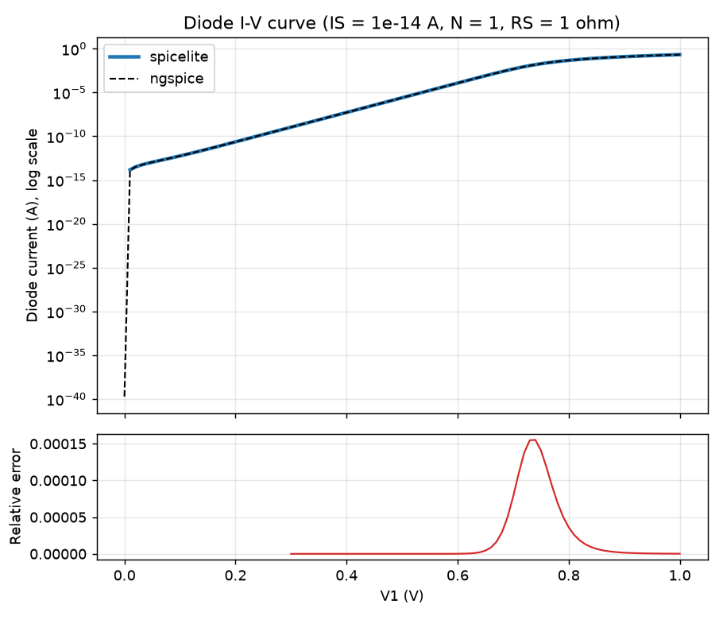

| Rectifier transfer curve | Two-diode clamp |
|---|---|
| 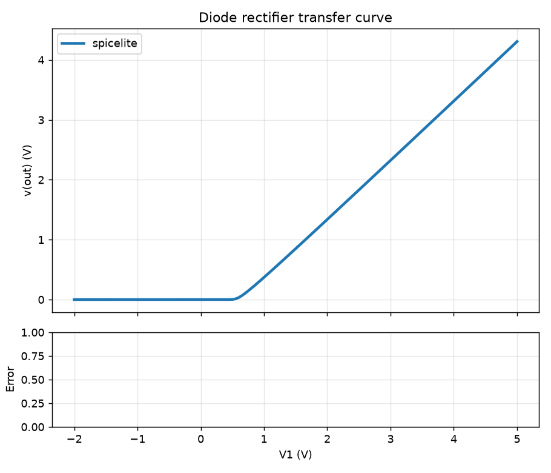 | 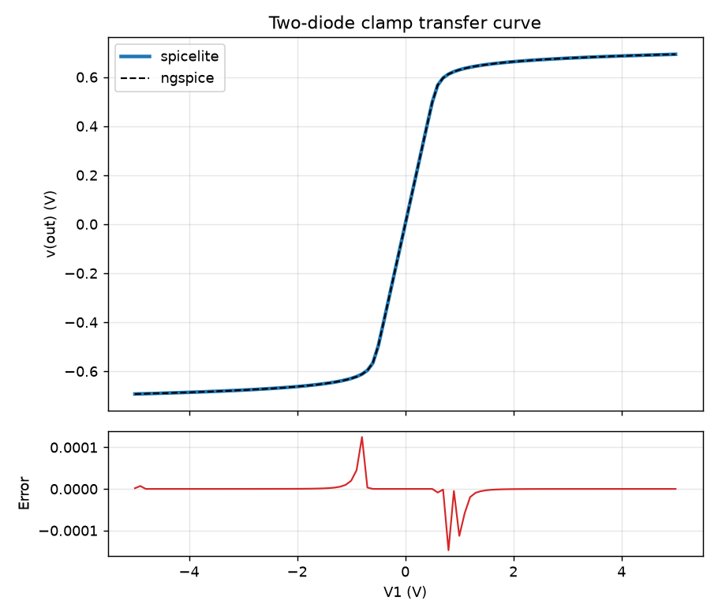 |

## Diodes in transient and AC analysis

**Transient.** The linear part of the circuit (resistors, the capacitor and inductor companion models,
source rows) is stamped once per step size; each time step then runs the same Newton loop as `.op`,
starting from the previous time point. Typical cost is 2-4 iterations per step (the worst step in each
example is 6-7). If a step fails to converge it is split into two half steps, recursively, up to 8
times (down to 1/256 of the nominal step) while the output stays on the fixed grid; a failure
after that raises `ConvergenceError` with the time and the unknown still moving. The result reports
`iterations` per step and the total `cuts`.

**AC.** The DC operating point is found with Newton, then each diode is replaced by its small-signal
conductance `g = di/dv` at that bias (`rd = N Vt / Id`), and the usual complex sweep runs. It matches the
analytic divider-with-`rd` response to 1e-9 and ngspice to 6e-11 relative (ngspice linearises at its own
bias point, which is only good to ~1e-4 with its default tolerances, so the comparison tightens it).

| Half-wave rectifier, 10 uF filter | Two-diode clamp, sine in |
|---|---|
| 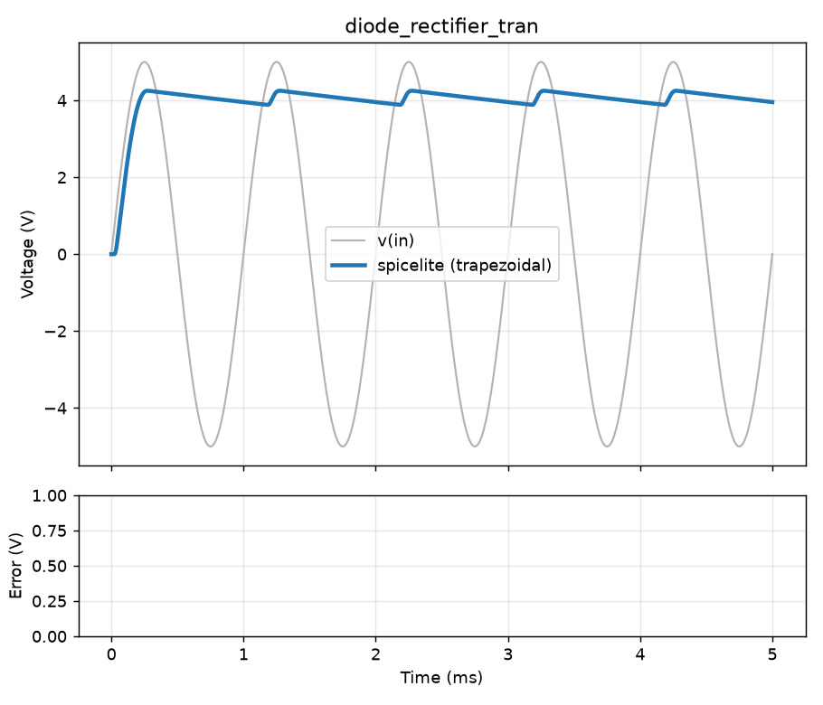 | 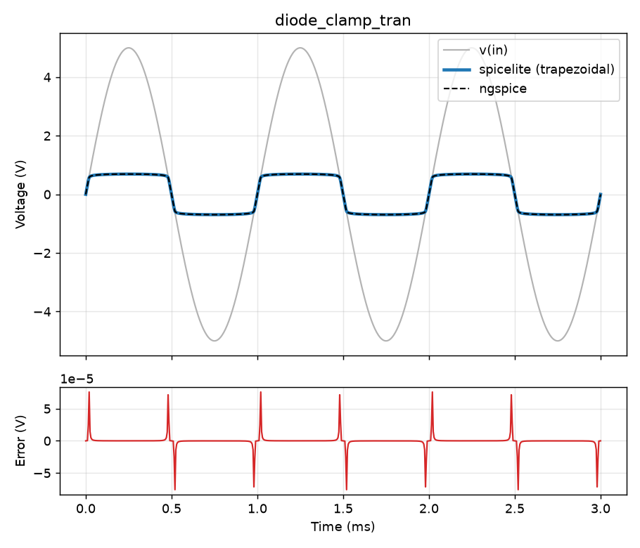 |

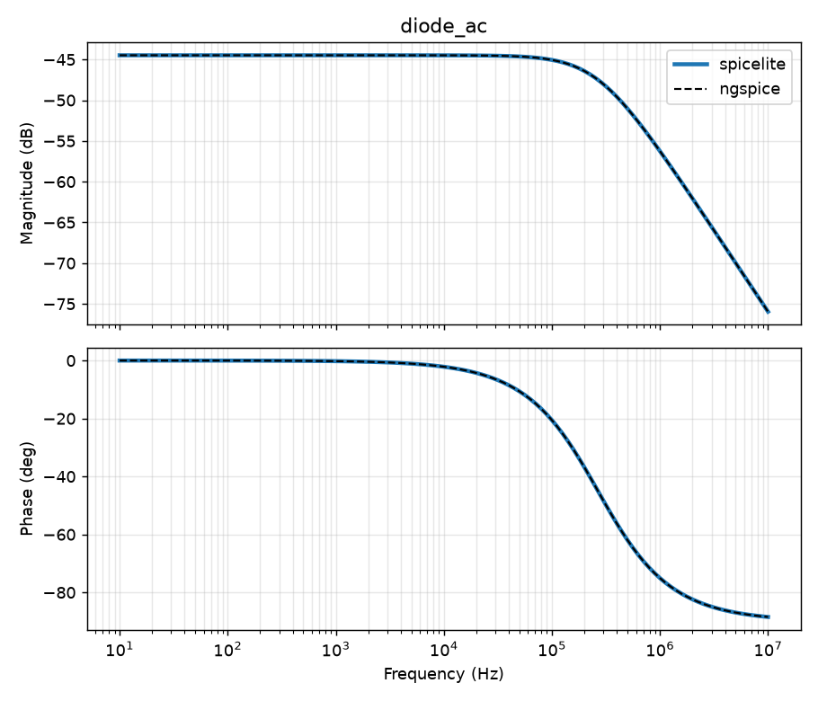

**Trapezoidal ringing at a diode turn-off.** Trapezoidal is not damped. When a diode switches off into a
circuit whose time constant is much shorter than the step, the output undershoots and rings around the
true answer (here below 0 V, which a diode would never allow); backward Euler decays monotonically.

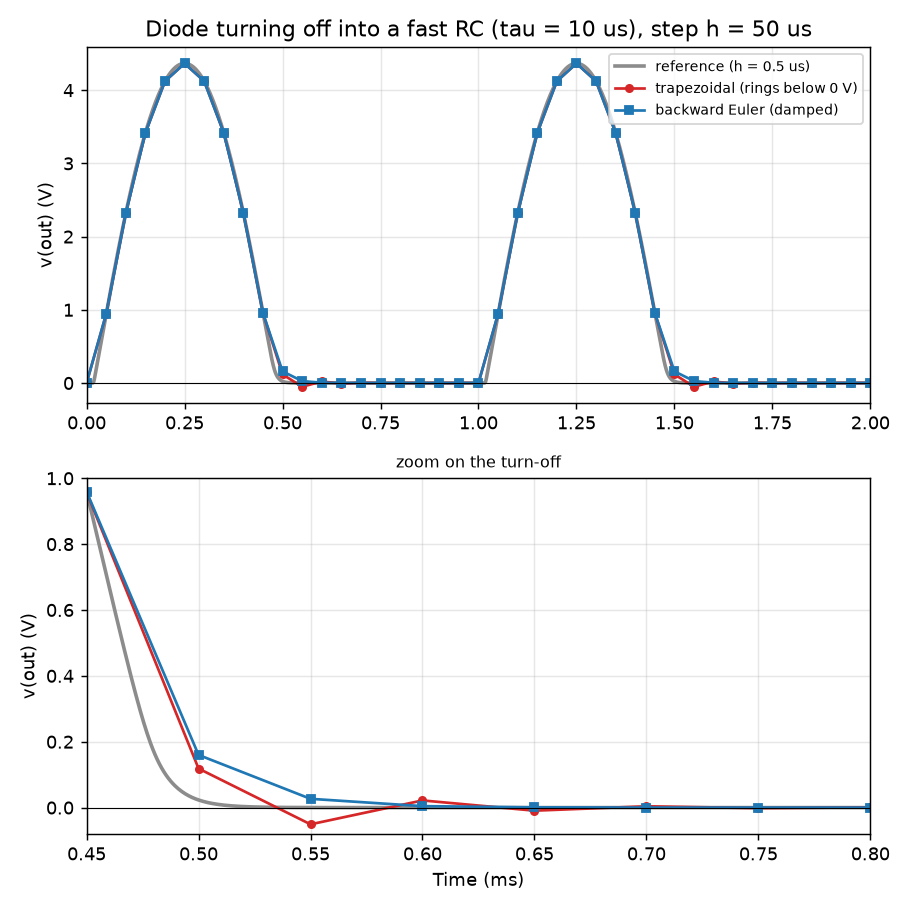

## Controlled sources and op-amps

| | Netlist | Equation | Extra branch unknown? |
|---|---|---|---|
| VCVS | `E name n+ n- nc+ nc- gain` | `v(n+) - v(n-) = gain (v(nc+) - v(nc-))` | yes (a voltage output) |
| VCCS | `G name n+ n- nc+ nc- gm` | current `gm (v(nc+) - v(nc-))` flows `n+ -> source -> n-` | no |
| CCCS | `F name n+ n- Vsense gain` | current `gain i(Vsense)` flows `n+ -> source -> n-` | no (reuses Vsense's) |
| CCVS | `H name n+ n- Vsense rm` | `v(n+) - v(n-) = rm i(Vsense)` | yes (a voltage output) |

All four are linear and memoryless, so they stamp the same real entries in DC, in the complex AC matrix
and in every transient step (a linear transient still factors its matrix once). The stamps are in
`elements.py` with their patterns in the docstrings.

**Sign convention (same as ngspice).** The sense current `i(Vsense)` is the branch current of a `V`
source: positive when current flows *into its + terminal and through it*. A source that delivers power
therefore reads negative. `G` and `F` currents, like an `I` source's, flow from `n+` through the source to
`n-`, so `G1 out 0 in 0 2m` *pulls* current out of node `out` (a positive input gives a negative output).
Reversing the sense source's terminals flips the sign of what `F` and `H` produce. `tests/test_controlled.py`
checks every orientation (both sense orientations, a power-delivering sense source, swapped output and
control terminals) against ngspice.

**Op-amp.** An op-amp is an `E` with a large gain (`E1 out 0 in+ in- 1e6`; `spicelite.opamp()` builds one
with the default `OPAMP_GAIN = 1e6`). I reused the VCVS rather than adding a new element because it needs
no new stamp or solver code and the finite gain makes the *finite-gain error* of a closed loop visible and
testable: the inverting amplifier's gain is `-(R2/R1) / (1 + (1 + R2/R1)/A)`, within 1e-9 of that formula
for A from 1e2 to 1e8, and the error falls as `110/A`. The alternative, a *nullor* (an ideal op-amp that
forces `v(in+) = v(in-)` with an unconstrained output current), is not implemented: it needs its own stamp,
cannot be used open loop, and has no finite-gain error to study.

An op-amp with no feedback path from its output to its inputs (a gain >= 1e3 `E` whose output cannot reach
its control nodes except through ground) raises an `OpenLoopWarning`, because its output is then just
`gain x` the differential input. A floating input is a `SingularCircuitError` naming the node.

### Examples against ngspice

| Inverting amplifier | Integrator | Sallen-Key low-pass |
|---|---|---|
| gain -10, DC + AC + `.dc` | `v(out) = -(1/RC) integral v(in)` | `f0 = 562.7 Hz`, `Q = 1.414` |

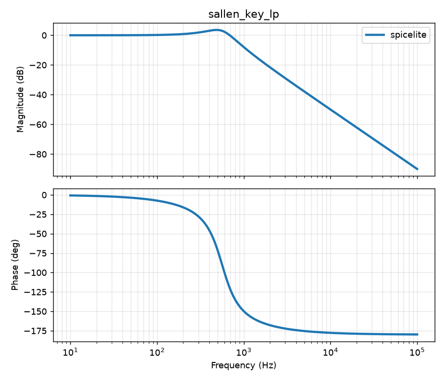

The Sallen-Key response matches the second-order transfer function to 1e-5 (the follower's finite gain
accounts for the rest); `|H(f0)| = Q` to 1e-5 with phase -90 degrees, and the peak frequency and height
match `f0 sqrt(1 - 1/(2Q^2))` and `Q / sqrt(1 - 1/(4Q^2))`.

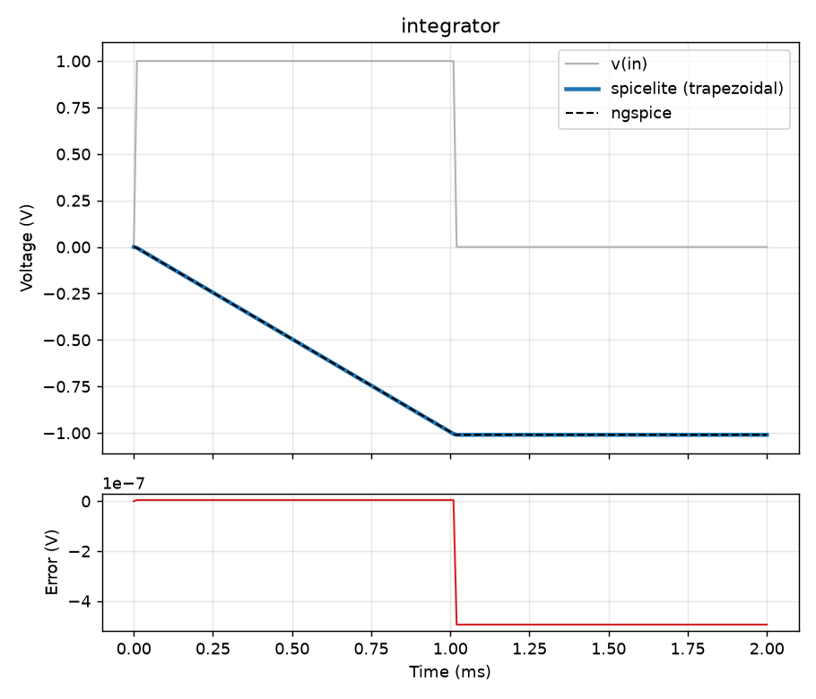

Against ngspice: linear DC and `.dc` agree exactly, AC to 3e-15 relative, and transient to 1e-5 of peak
(the O(h^2) trapezoidal error, as for the other RC circuits; the integrator is 5e-7).

## MOSFETs (level 1, Shichman-Hodges)

`M name drain gate source bulk model [W=..] [L=..]` with `.model name NMOS|PMOS (LEVEL=1 VTO KP LAMBDA GAMMA PHI)`
(W and L default to ngspice's 100 um; VTO keeps its natural sign, so an enhancement PMOS has `VTO=-1`). With
beta = KP W/L, Vov = Vgs - Vth and Vth = VTO + GAMMA (sqrt(PHI - Vbs) - sqrt(PHI)):

| Region | Condition | Id |
|---|---|---|
| cutoff | Vov <= 0 | 0 |
| triode | Vds < Vov | beta (Vov Vds - Vds^2/2)(1 + LAMBDA Vds) |
| saturation | Vds >= Vov | beta/2 Vov^2 (1 + LAMBDA Vds) |

A PMOS is the NMOS equations with every voltage and current negated; if Vds changes sign the drain and source swap roles
(the channel is symmetric). Newton linearises the device into gm, gds and gmbs plus a current source (`elements.stamp_mosfet`),
limits Vgs and Vds each iteration exactly as SPICE's `fetlim` and `limvds` do, and falls back to gmin stepping. In AC
the device is its three conductances at the bias point. Both bulk junctions contribute only their 1e-12 S GMIN
(this is what keeps a node of cut-off devices solvable, and matches ngspice's default). Circuits with MOSFETs stay on the dense solver.

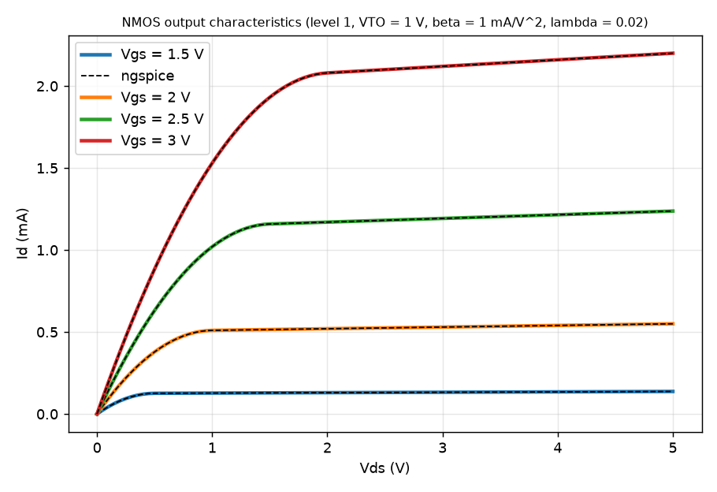

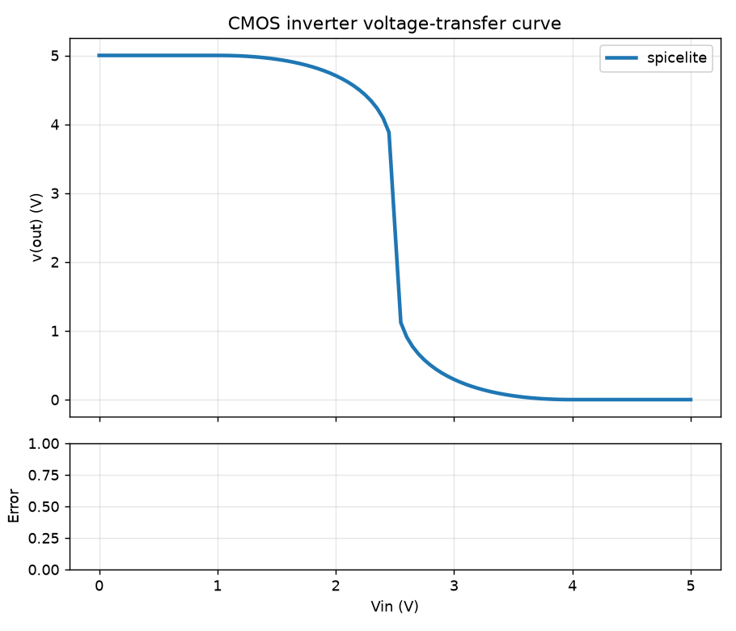

| Example | Analysis | Tolerance vs ngspice | Observed worst |
|---|---|---|---|
| `nmos_iv` (4 gate voltages) | `.dc` | 1e-9 of peak | 8e-12 |
| `cmos_inverter_vtc` | `.dc` | 5e-8 of peak | 6.5e-10 (3.3e-9 V at the switching point) |
| `nmos_common_source` | `.op` / `.ac` | 1e-9 / 1e-6 relative | 1e-11 / ~1e-9 |
| `cmos_inverter_tran` | `.tran` (0.0125 ns) | 1.2e-3 of peak | 2.6e-4 (O(h^2): 4x per halving of h) |
| body-effect follower, PMOS load, reverse conduction (inline netlists) | `.dc` | 1e-8 of peak | see `tests/test_mosfet.py` |

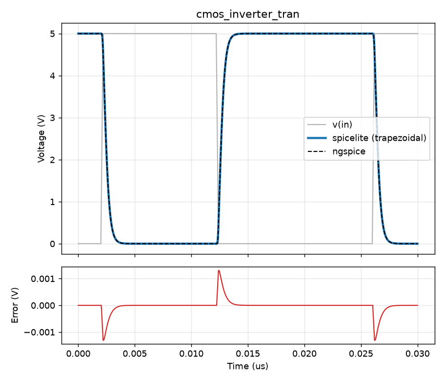

## Step control and initial conditions

`.tran tstep tstop [uic]` is fixed-step by default (trapezoidal, LU factored once). `.options step=adaptive`
(or `tran(circuit, adaptive=True)` / `adaptive=StepControl(rtol=..., hmin=..., hmax=..., max_steps=...)`) switches
to **local-truncation-error control**: after every step the error is estimated from divided differences of the
accepted points (trap: h^3 |DD3| / 2, backward Euler: h^2 |DD2|, no extra solve), a step is accepted if it is within
`rtol` of each unknown (default 1e-4, plus 1 uV / 1 nA floors), and the next step is h (0.9 r^(-1/(p+1))) limited to
0.5x-2x, rounded down to hmax / 2^k so factored matrices are reused. Steps land exactly on every PULSE / SIN corner (the
history restarts at `tstep` after a corner). `tstep` is the initial and restart step, `hmax` defaults to tstop / 50,
`hmin` to tstop x 1e-9; going below `hmin` or past `max_steps` raises a `ConvergenceError` that says where.
`adaptive=False` forces the fixed-step path, which is unchanged (`tests/test_regression.py`).

| Circuit | Fixed | Adaptive | Max error |
|---|---|---|---|
| `rc_step`-style RC, 5 ms, tau = 1 ms (trap) | 5001 steps (1 us) | 94 steps | 6.8e-5 (analytic) |
| `stiff_adaptive` (tau = 1 us and 10 ms, 50 ms) | 5000 steps: error 0.17; no fixed step under 5e5 steps reaches 5e-2 | 191 steps | 5e-4 (analytic), 3.3e-4 of peak vs ngspice |
| `rlc_ring_adaptive` (Q ~ 10, 4 ms) | ngspice: ~20000 points | 2154 steps (38 rejected) | 4.7e-3 of peak vs ngspice (accumulated over ~20 periods) |

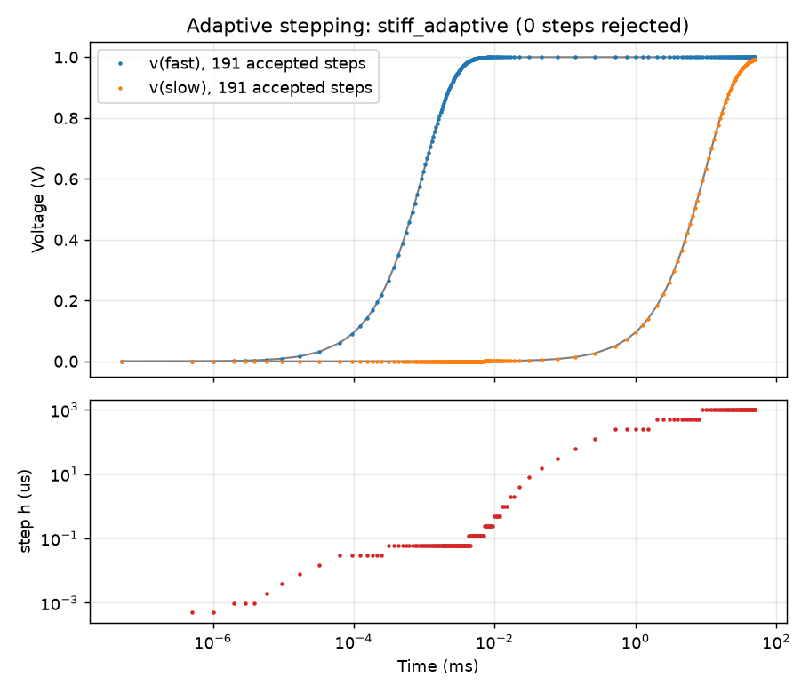

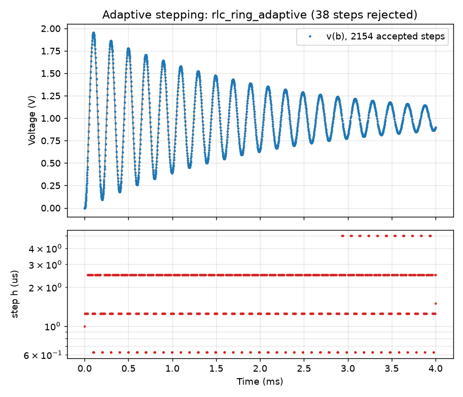

The cost: the matrix depends on h, so an adaptive linear run re-factors whenever h changes (few distinct sizes thanks to the
power-of-two grid), where a fixed-step run factors once. It pays off when it saves many more steps than that, as above;
for a circuit with one time scale the fixed-step fast path is cheaper. The global error is the per-step error accumulated over
the run (an oscillator with Q ~ 10 over 20 periods ends ~50x above rtol), and falls roughly as rtol^(2/3).

**Initial conditions.** `.ic v(node)=value` with `.tran ... uic` skips the DC operating point: capacitor voltages start at the
given values (unspecified nodes at 0, inductor currents at 0), which also works for circuits that have no DC solution
(`examples/rc_ic_discharge.cir`: a capacitor discharging through a resistor from 5 V, compared with the analytic exponential and
ngspice).

## Sparse solves and benchmark

An MNA matrix is mostly zeros (each element touches only its own nodes), so `spicelite.sparse` assembles it as
(row, col, value) triples (every stamp is a `+=`, so the same stamp functions serve both paths), converts to
CSC and factors with SuperLU. `solver="auto"` (the default) picks dense below 60 unknowns, where LAPACK on
a tiny matrix is faster than sparse bookkeeping, and sparse from there on. Dense and sparse give the same answers
to round-off on every example (`tests/test_sparse.py`, 1e-9 relative). Circuits with diodes stay dense, because the
Newton loop edits a dense copy of the matrix each iteration; `solver="sparse"` on such a circuit is an error.

`python benchmarks/bench_sparse.py` times a long RC ladder (best of 3, 1 for the largest; assembly included;
`.tran` is 100 trapezoidal steps, so one factorisation plus 100 back-substitutions). Measured on the
author's Windows 11 laptop, Python 3.12, scipy 1.18:

| sections | unknowns | .op dense | .op sparse | speed-up | .tran dense | .tran sparse | speed-up |
|---:|---:|---:|---:|---:|---:|---:|---:|
| 100 | 102 | 0.0480 s | 0.0013 s | 37.5x | 0.2205 s | 0.0237 s | 9.3x |
| 1000 | 1002 | 0.8634 s | 0.0113 s | 76.7x | 2.9051 s | 0.2560 s | 11.3x |
| 10000 | 10002 | 5.2920 s | 0.1183 s | 44.7x | 43.3431 s | 3.2395 s | 13.4x |

Below about 60 unknowns dense wins or ties (12 unknowns: 0.2 ms dense vs 0.5 ms sparse for `.op`), which is why
`auto` keeps tiny circuits dense. The ladder is the best case for sparse (a tridiagonal matrix); a circuit
where every node connects to every other would see little benefit. Timings are noisy at the small end: the
100-section dense `.op` ranges from 0.01 to 0.05 s between runs, depending on when the BLAS thread pool wakes up.

## Initial conditions: `.ic` and `uic`

`.tran tstep tstop uic` skips the DC solve and starts from `.ic v(node)=value` capacitor voltages
(unlisted nodes are 0) and zero inductor currents, as in SPICE.

Trapezoidal integration also needs each capacitor's current and each inductor's voltage at t = 0+, not
just the state variables. They are found by solving the circuit at t = 0+ with every capacitor held at
its voltage (as a voltage source) and every inductor at its current (as a current source). This also
fixes a flaw in the first transient version: with a zero-rise step at t = 0, trapezoidal averaged the
capacitor current *before* the step (0) with the one after, which cut it to first order. It now
converges at second order for ideal steps too (error ratio 4.00 per halving of the step).

| RC discharge from `.ic v(out)=5` | RLC ring-down from `.ic v(a)=1` |
|---|---|
| 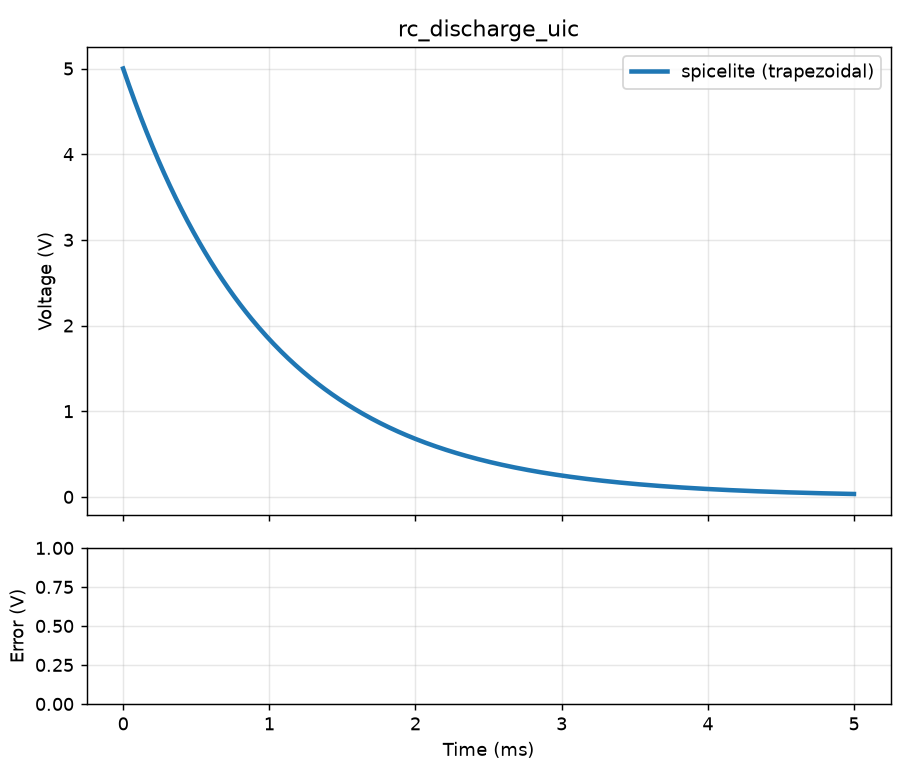 | 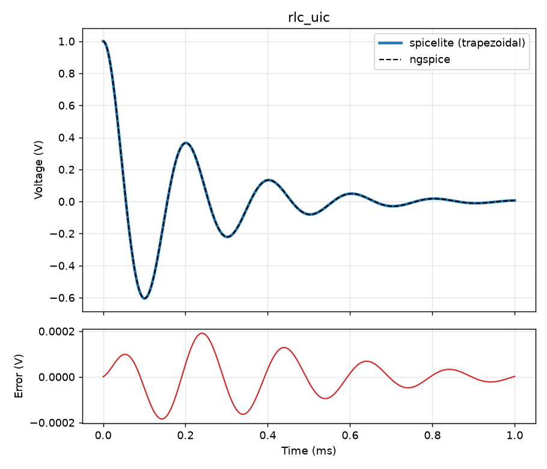 |

## Results vs ngspice (linear analyses)

### AC (Bode, complex values agree with ngspice to better than 1e-12 relative)

| RC lowpass | RL highpass | RLC bandpass |
|---|---|---|
| 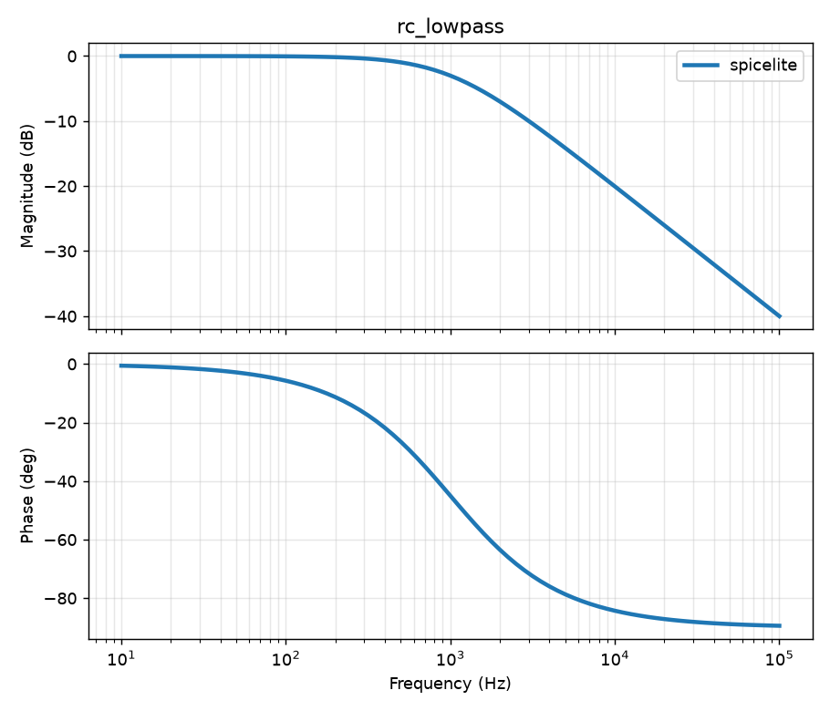 | 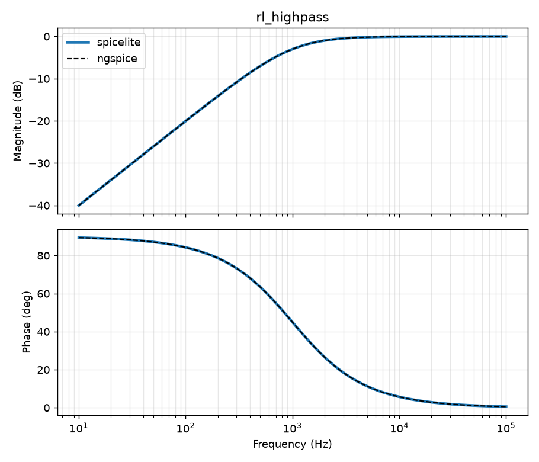 | 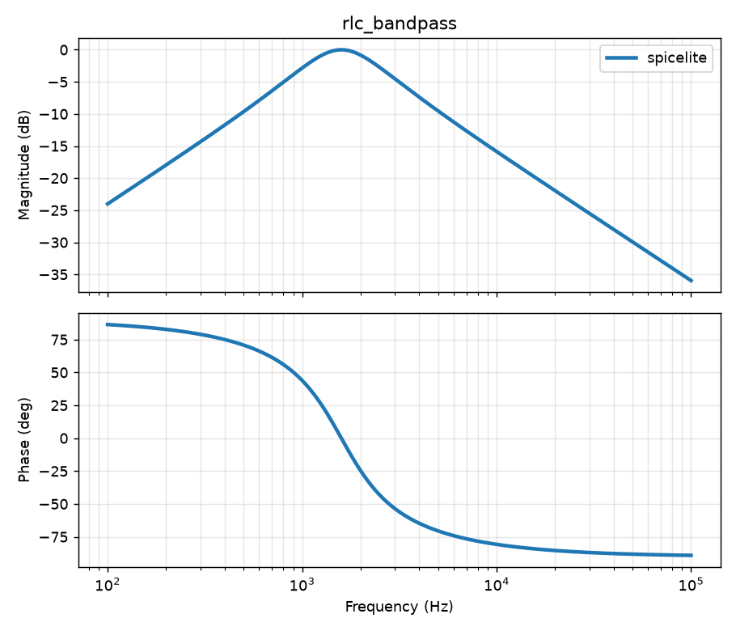 |

### Transient (trapezoidal vs ngspice with tightened tolerances, error curve underneath)

| RC pulse | Underdamped RLC | Sine into RL |
|---|---|---|
| 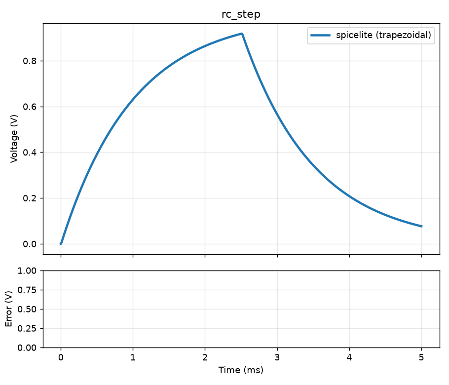 | 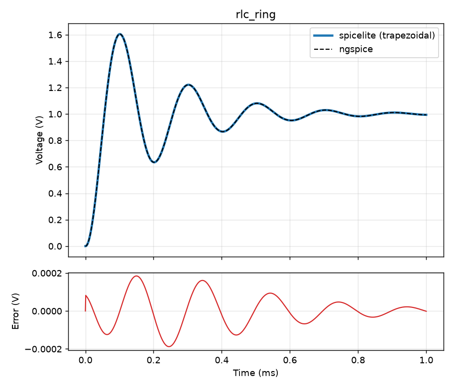 | 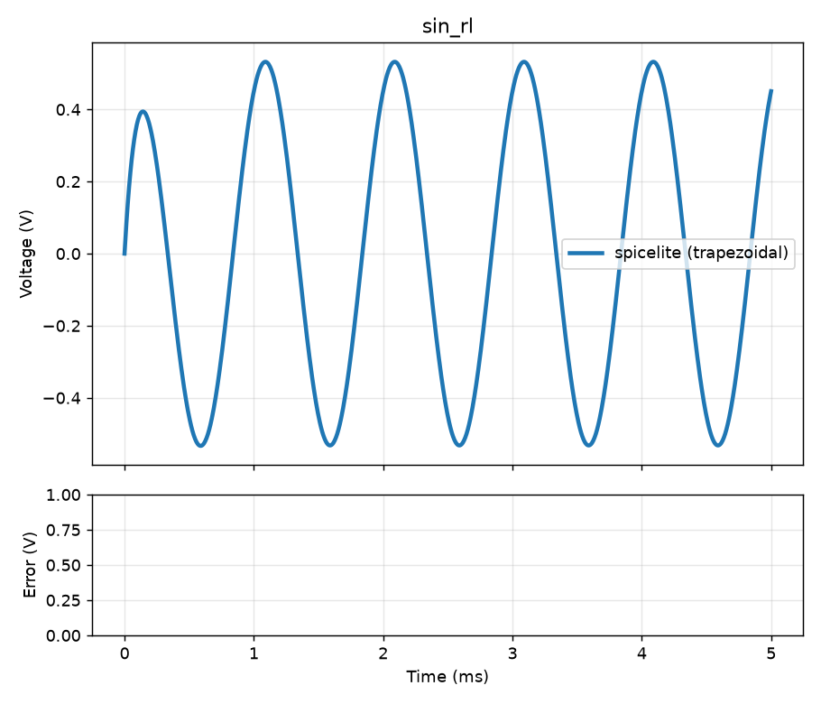 |

The gap to ngspice is spicelite's own O(h^2) trapezoidal error: halving the step cuts it 4x.

### Trapezoidal ringing vs backward Euler damping

When the step is much larger than the circuit's time constant, trapezoidal is not damped and
rings around the true answer after a sudden input change; backward Euler stays monotonic (at the
cost of being only first-order accurate). The overshoot is large because the input steps at t = 0
and the step is 20 time constants.

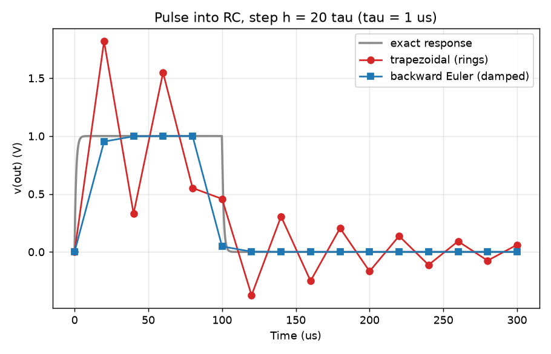

Convergence on an RC step response (halving h): backward Euler's error falls ~2x per halving,
trapezoidal's ~4x, for ramped steps and, since the t = 0+ initialisation, for ideal steps as well.
