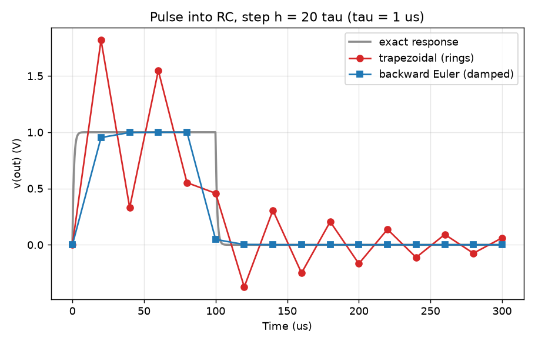
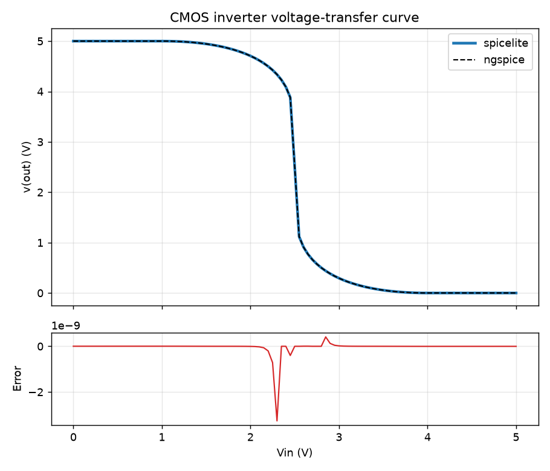

# Building a SPICE simulator from scratch and checking it against ngspice

*For other engineering students. Every number below comes from this repository's tests, reports or scripts, and I name the command that regenerates it. Places where I could only guess at the author's own experience are marked `[EDIT: ...]`.*

## Why I built it

[EDIT: this paragraph is my guess at the motivation; replace it with yours, e.g. a circuits course or an interest in semiconductor and hardware work.] SPICE is easy to use as a black box: type a netlist, get a plot, trust it. I wanted to know what is inside. So the rule for the project was simple: write the solver myself (numpy and scipy only do the linear algebra), and compare every result with ngspice, with a tolerance I have to justify in the test next to it.

I built it with an AI coding assistant (Claude Code; the commits say so). [EDIT: describe your actual role plainly, for example which parts you specified, reviewed and made decisions on. Readers will ask.] What exists now is about 3,200 lines of Python in `src/spicelite`, 824 tests (65 of them compare against ngspice 41), and a version that runs in the browser. The result is a teaching-scale simulator, not a rival to ngspice; the README lists what it does not do.

## Modified nodal analysis in one example

Take a divider: V1 = 10 V, R1 = 1 kΩ from `in` to `out`, R2 = 2 kΩ from `out` to ground. Nodal analysis writes Kirchhoff's current law at every node except ground. A resistor between two nodes adds its conductance `G = 1/R` to the two diagonal entries and subtracts it from the two off-diagonal ones. That works until you meet an ideal voltage source: it has a fixed voltage but an unknown current, and a nodal equation cannot express "this node is exactly 10 V". Modified nodal analysis adds the source's current as one more unknown, and one more equation: `v(in) = 10`. That is the whole idea.

For this circuit the unknowns are `v(in)`, `v(out)` and `i(V1)`, and the matrix the code builds (`mna.build`) is:

```
          v(in)    v(out)   i(V1)  |  b
v(in)     0.001   -0.001     1     |  0
v(out)   -0.001    0.0015    0     |  0
V1 row    1        0         0     |  10
```

The first two rows are KCL at `in` and `out` (R2's 0.5 mS appears only in the `out` diagonal: 1 mS + 0.5 mS = 1.5 mS); the third row says `v(in) = 10`, and the `1` in the last column is the source's current leaving node `in`. Solving gives `v(out) = 6.667 V` and `i(V1) = -3.333 mA`. The negative sign is the SPICE convention: branch current is positive when it flows into the source's + terminal, so a source that delivers power reads negative. In the code each element's contribution is one short function in `elements.py` with its pattern in the docstring, so you can read the stamp next to the matrix it makes.

## Capacitors and inductors: companion models

A capacitor has `i = C dv/dt`, which is not an algebraic relation between this instant's voltage and current. Time stepping fixes that. Choose a step `h` and approximate the derivative over one step. With backward Euler, `i_new = (C/h)(v_new - v_old)`. Read it as a circuit: a conductance `C/h` across the capacitor, in parallel with a current source `(C/h) v_old` that depends only on the *previous* step. The capacitor has become a resistor and a source, which MNA already knows how to stamp. Trapezoidal averages the old and new slope instead: the conductance is `2C/h` and the source also carries the old current, `i_new = (2C/h)(v_new - v_old) - i_old`. An inductor does the same job in its branch row, with `L/h` or `2L/h`.

The part I like most: the conductance is `s*C` with `s = 1/h` (backward Euler) or `2/h` (trapezoidal), and in AC analysis it is `s*C` with `s = jω`. One stamp function serves all three, and for a linear circuit the transient matrix depends only on `h`, so it is LU-factored once and every time step is just a back-substitution.

## Why trapezoidal beats backward Euler

Backward Euler is first-order accurate: halve the step and the error halves. Trapezoidal is second-order: halve the step and the error drops by four. I did not want to take that on faith, so the test suite measures it, and `python scripts/convergence_table.py` regenerates the table (full version in [`convergence.md`](convergence.md)). The circuit is an RC low-pass with τ = 1 ms, driven by a ramp so the exact answer is known; the error is the largest difference to it:

| h / τ | backward Euler error | per halving of h | trapezoidal error | per halving of h |
|---:|---:|---:|---:|---:|
| 0.125 | 3.553e-02 | | 7.914e-04 | |
| 0.0156 | 4.699e-03 | 1.98x | 1.234e-05 | 4.00x |
| 0.0039 | 1.182e-03 | 2.00x | 7.712e-07 | 4.00x |

(Every third row of the full table; the ratio columns are the error ratio between neighbouring rows of the full table, i.e. per halving of h.) At the smallest step trapezoidal is about 1,500 times more accurate (1.182e-3 / 7.712e-7), for the same single factorisation. The same factors of 2 and 4 hold for an ideal step at t = 0, but only after I fixed the initial condition: at first the zero-rise step dropped trapezoidal to first order, because it averaged the capacitor's current *before* the step (zero) with the one after. The code now solves the circuit at t = 0+ with each capacitor held at its voltage to get a consistent starting current.

Trapezoidal's weakness is that it does not damp. Take a 1 µs RC and step 20 µs, twenty time constants. Backward Euler rises to 0.952 V, 0.998 V, 1.000 V. Trapezoidal returns 1.818 V, 0.331 V, 1.548 V, 0.552 V for a 1 V input: it rings around the true answer, and overshoots above the 1 V a passive RC can never exceed.



So the choice is a tradeoff, not a ranking: trapezoidal is the better default when the step resolves the dynamics, backward Euler is the safe choice when it does not. Adaptive stepping (local truncation error control) is the practical answer: for an RC step response over 5 ms with τ = 1 ms, the README's table lists 5001 fixed 1 µs steps against 94 adaptive steps, the adaptive run's maximum error being 6.8e-5 against the analytic solution.

## Newton-Raphson, and why diodes need voltage limiting

A diode's current `i = Is (e^(v/(N Vt)) - 1)` is not linear in `v`, so MNA cannot solve it in one shot. Newton-Raphson linearises it around the current guess: a conductance `g = di/dv` in parallel with a current source `Ieq = i(v0) - g v0`. These are stamped like any resistor and source, the linear system is solved, and the guess moves; repeat until the voltages and currents stop changing.

The trap is the exponential. Put 5 V across a diode and a 1 kΩ resistor and start at 0 V: the slope there is about 4e-13 S, so Newton's tangent says the diode is an open circuit and moves the diode to 5.000 V in one step. `e^(5/0.0259)` is about `e^193`, so the next iteration begins from a current of order 1e70 and has to crawl back. I wrote a small script (`python scripts/newton_limiting_demo.py`) that runs bare Newton next to spicelite:

| Source | bare Newton | spicelite |
|---:|---|---|
| 1 V | 20 iterations | 8 iterations |
| 5 V | 173 iterations | 7 iterations |
| 1000 V | overflows on the second step | 9 iterations |

(The two counts use different stopping rules, so compare the orders of magnitude, not the digits.) SPICE's answer, `pnjlim`, is to limit how far a junction voltage may move per iteration: above the critical voltage, a jump of more than 2 Vt is replaced by a logarithmic step `v_old + Vt (2 + ln((v_new - v_old)/Vt - 2))`, so the voltage creeps up instead of jumping. `tests/test_diode.py` checks that exact formula. Convergence is declared on both voltages and currents, and if plain Newton still fails there is a fallback, gmin stepping: add a large conductance from every node to ground so the circuit is nearly linear, then shrink it a decade at a time. One test shows it working: for a 1 V diode circuit plain Newton takes 8 iterations, capped at 5 it raises `ConvergenceError` naming the worst node, and with the fallback the same cap succeeds and gives the same answer to 1e-9 relative.

## The bug that taught me the most: a silent MOSFET

Not a crash: a plausible wrong answer. While removing duplicated element-stamping code, the audit found that `mna.build` silently dropped MOSFETs. The guard that stops a nonlinear device from being assembled without Newton-Raphson covered diodes only, so a MOSFET circuit built directly through that function came back with the transistor missing and a reasonable-looking result. The analyses themselves were not affected, because they route MOSFET circuits through Newton, so no published result was wrong; but the public function was.

Why the tests had not caught it: the MOSFET's stamp was right, the analyses were right, and the comparison with ngspice goes through the analyses. The mistake was in which elements one assembler visits, and nothing exercised that. The fix went in the order I now trust: a failing test first (`test_mna_build_refuses_a_mosfet_instead_of_silently_dropping_it`), then a refusal instead of a quiet skip. The larger fix was the refactor behind it: every analysis now stamps through one registry (`elements.STAMPS`), so an element type that is not registered everywhere fails the suite. I checked that by deleting one entry. The lesson I keep: a wrong number that looks fine is worse than a crash.

A smaller one in the same spirit: `10u` must parse to exactly `1e-5`, but `10 * 1e-6` in floating point is `9.999999999999999e-06`, so the parser scales in decimal. There is a regression test for it. [EDIT: if you remember what actually went wrong when this first showed up, add it here in a sentence; I only know the fix and the test.]

## What ngspice caught that my unit tests could not

Unit tests check my understanding; ngspice checks it against someone else's. Three examples from the repository's own notes:

1. **Conventions.** A test of my own stamp passes whichever sign convention I pick. ngspice fixes it: the controlled-source sense current is positive into the sensing source's + terminal, and a `G` source pulls current out of its `n+` node. `tests/test_controlled.py` checks the orientations (both sense directions, swapped output and control terminals) against ngspice.
2. **The reference has error too.** Against ngspice's default tolerances, my diode `.dc` sweeps differ by up to 2e-4 of the signal's peak. Against the exact Lambert-W solution of the diode circuit, mine is within 1e-11 relative (worst of 8 cases 2.4e-12), so the gap is ngspice stopping early with `reltol = 1e-3`. With ngspice's tolerances tightened to mine the difference falls below 1e-9. An analytic answer is a useful third witness.
3. **Model differences.** ngspice's MOSFET includes bulk-junction diodes; mine reduces them to a tiny conductance. In the `nmos_iv` example that shows up as 8e-12 of peak (junction leakage ngspice has and I do not), and I list it as a limitation: a bulk biased more than about 0.6 V above a channel terminal conducts in ngspice and not here.



The same discipline explains the loose transient tolerances (for example 5e-5 of peak for the RC step, 1e-3 for the RLC ring-down): ngspice is run tightly, so the gap *is* my O(h²) trapezoidal error, which the test comments show falling 4x per halving of the step. A tolerance with a reason beats a tolerance that happens to pass.

## What I would do next

[EDIT: choose your own next steps; these are the three limitations the repository's notes already name.] Intrinsic MOSFET capacitances (Meyer), a one-pole op-amp, and a proper fix for trapezoidal ringing on capacitor currents between ideal sources. The README's Limitations section lists everything else. The code, tests and every figure here are in the repository; the live demo runs the same Python in your browser through Pyodide, and nothing you type leaves the page.
